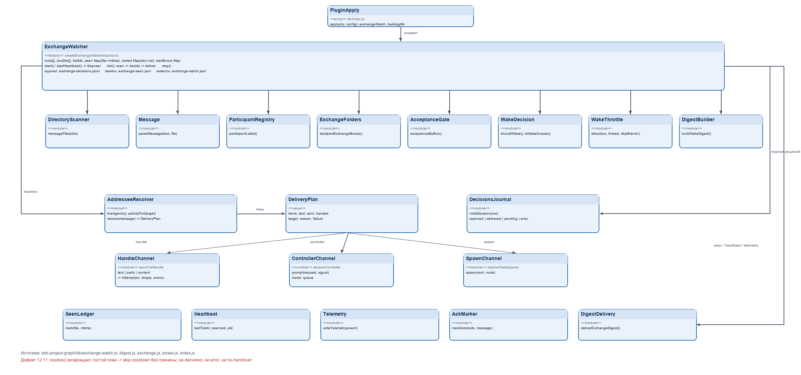

# Обмен между воркспейсами — диаграмма классов (исправленная)



Источник: `dsh-project-graph/lib/exchange-watch.js`, `lib/digest.js`, `lib/exchange.js`, `lib/boxes.js`, `lib/index.js`.

Синтаксис проверен на консервативном подмножестве Mermaid (без generics, без `|` и `{}` в сигнатурах).

```mermaid
classDiagram
  class ExchangeWatcher {
    <<factory>>
    +array roots
    +array boxDirs
    +number tickMs
    +Map seen
    +Map retried
    +Map startErrors
    +start() disposer
    +startHeartbeat() disposer
    +tick() Promise
    +stop() void
  }

  class WakeThrottle {
    <<factory>>
    +Map branches
    +Map boxes
    +number branchMs
    +number boxLimit
    +number boxWindowMs
    +allow(box, branch, now, skipBranch) Verdict
    +mark(box, branch, now) void
  }

  class ExchangeFolders {
    <<module>>
    +declaredExchangeBoxes() array
    +declaredExchangeWorkspaces() array
    +resolveFolderBox(folder, root) string
    +readExchangeFolders(runtime, root) array
  }

  class DirectoryScanner {
    <<module>>
    +messageFiles(dirs) array
  }

  class Message {
    <<value>>
    +string from
    +string to
    +string status
    +string thread
    +string ref
    +string replyTo
    +string subject
    +string at
    +parseMessage(text, file) Message
  }

  class ParticipantRegistry {
    <<module>>
    +Map participantsByLabel
    +participantLabel(root, participants, exchange) string
    +labelRoots(roots, options) Map
    +addresseeLabels(to) array
  }

  class AddresseeResolver {
    <<internal>>
    +liveAgents() array
    +activityFor(target, now) Map
    +resolveWakeSpawn(input) Decision
    +getSessionController() Controller
    +resolve(message) DeliveryPlan
  }

  class AcceptanceGate {
    <<module>>
    +acceptanceByBox(runtime, list) Map
    +gate(box, to) string
  }

  class WakeDecision {
    <<module>>
    +shouldWake(status) boolean
    +isWakeAnswer(answerRef, addressee) boolean
    +wakeDecision(letter, context) Verdict
  }

  class DigestBuilder {
    <<module>>
    +buildWakeDigest(letters) string
    +wakeText(items) string
  }

  class DeliveryPlan {
    +string boxDir
    +array items
    +string text
    +boolean sent
    +boolean handed
    +string target
    +string failure
  }

  class HandleChannel {
    <<module>>
    +sendViaHandle(handle, text, options) Attempt
  }

  class ControllerChannel {
    <<runtime>>
    +prompt(request, signal) Promise
  }

  class SpawnChannel {
    <<module>>
    +spawn(root, node) childId
  }

  class DecisionsJournal {
    <<module>>
    +noteDecision(row) void
    +readDecisionRows(file) array
    +letterStates(rows) Map
    +journalStateOf(branch) string
  }

  class SeenLedger {
    <<module>>
    +readSeenMemory() Map
    +writeSeenMemory(map) void
    +recoverFalseSeen(options) number
    +mark(file, mtime) void
  }

  class Heartbeat {
    <<module>>
    +string lastTickAt
    +number scanned
    +string producer
    +number pid
    +writeHeartbeat(file, input) void
    +readHeartbeat(file) object
    +heartbeatState(options) object
  }

  class Telemetry {
    <<module>>
    +writeTelemetry(event) void
  }

  class AckMarker {
    <<module>>
    +markAck(roots, runtime, message, ackRel) void
  }

  class DigestDelivery {
    <<module>>
    +deliverExchangeDigest(options) Promise
    +number throttleMs
  }

  class PluginApply {
    <<entry>>
    +boolean exchangeWatch
    +number exchangeBacklogMs
    +apply(ctx, config) void
  }

  PluginApply --> ExchangeWatcher : creates
  ExchangeWatcher --> DirectoryScanner : scans
  ExchangeWatcher --> Message : parses
  ExchangeWatcher --> ParticipantRegistry : labels
  ExchangeWatcher --> ExchangeFolders : boxes
  ExchangeWatcher --> AcceptanceGate : gate
  ExchangeWatcher --> AddresseeResolver : resolve
  ExchangeWatcher --> WakeDecision : decide
  ExchangeWatcher --> WakeThrottle : limits
  ExchangeWatcher --> DigestBuilder : text
  ExchangeWatcher --> DeliveryPlan : plans
  ExchangeWatcher --> DecisionsJournal : journal
  ExchangeWatcher --> SeenLedger : seen
  ExchangeWatcher --> Heartbeat : beat
  ExchangeWatcher --> Telemetry : events
  ExchangeWatcher --> AckMarker : acks

  DeliveryPlan --> HandleChannel : live handle
  DeliveryPlan --> ControllerChannel : session prompt
  DeliveryPlan --> SpawnChannel : cold session

  AddresseeResolver ..> ParticipantRegistry : lookup
  WakeDecision ..> Message : status
  WakeThrottle ..> Message : thread key
  DigestDelivery ..> ExchangeWatcher : digest.json
```



## Тот же граф в ASCII (если Mermaid не отрисуется)

```
                    +-------------------+
                    |   PluginApply     |
                    | lib/index.js      |
                    +---------+---------+
                              | apply()
                              v
+--------------------------------------------------------------+
|                       ExchangeWatcher                        |
|  tick() / start() / startHeartbeat() / seen / retried        |
+---+--------+--------+--------+--------+--------+--------+----+
    |        |        |        |        |        |        |
    v        v        v        v        v        v        v
 Directory  Message  Participant Exchange Acceptance WakeDecision
 Scanner    parse    Registry    Folders  Gate
    |                 |                                    |
    |                 v                                    v
    |          AddresseeResolver ---> DeliveryPlan <--- WakeThrottle
    |                 |                  |
    |                 |            +-----+------+--------+
    |                 |            v            v        v
    |                 |        HandleChannel Controller Spawn
    |                 |        sendViaHandle  .prompt
    |                 |
    +--------+--------+-------> DecisionsJournal / SeenLedger / Heartbeat
```

## Где ломается (12.11)

Письмо сканируется (`scanned` растёт), затем получает `skip:cooldown` без причины.
`AddresseeResolver.resolve()` возвращает пустой план: ни handle, ни controller, ни spawn.
`DeliveryPlan` не создаётся — значит нет ни `delivered`, ни `error`, ни `no-handover`.
Дефект на стыке **ParticipantRegistry → AddresseeResolver**.
